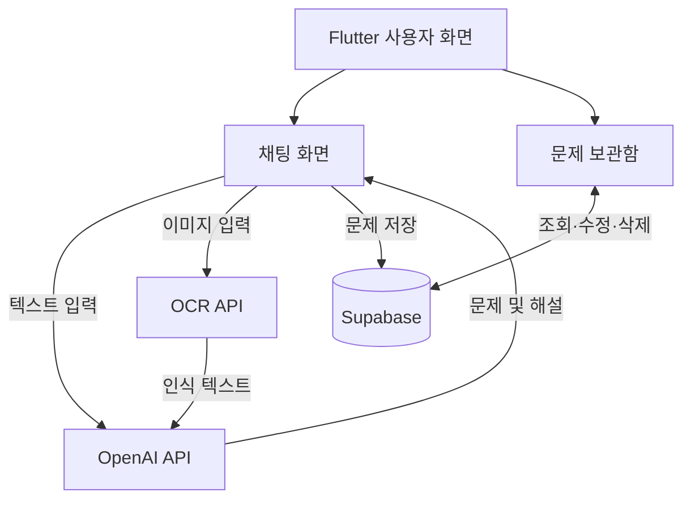

<p align="center"></p>

# 문제메이트 · Moonje Mate

**학습 키워드와 이미지에서 새로운 연습문제를 만드는 AI 학습 앱**

산업공학 캡스톤 팀 프로젝트 (2024) · Flutter / Dart · OpenAI API · OCR · Supabase

[팀 프로젝트 저장소](https://github.com/leunchan/brain-app) · [핵심 구현](lib/screen/chat_screen.dart) · [문제 보관함](lib/screen/storage_date_screen.dart)

## 01. 프로젝트 배경

특정 개념을 반복 학습할 때 적합한 문제를 직접 찾거나 만드는 과정이 번거롭다. 문제메이트는 텍스트 또는 이미지 속 학습 내용을 입력받아 문제 생성, 해설, 저장 및 재학습으로 이어지는 흐름을 모바일 앱 안에서 제공한다.

## 02. 주요 기능

| 기능 | 설명 |
| --- | --- |
| AI 문제 생성 | 학습 키워드에 맞는 문제를 채팅 화면에 표시 |
| AI 해설 | 문제 생성과 구분된 요청으로 해설 제공 |
| 이미지 OCR | 이미지에서 인식한 텍스트를 문제 생성 입력으로 활용 |
| 문제 보관함 | 생성한 문제 저장, 태그별 조회, 태그 수정 및 삭제 |
| 사용자 관리 | 회원가입, 로그인, 사용자 정보 및 설정 화면 |

## 03. 시스템 구조



## 04. 핵심 구현

- [chat_screen.dart](lib/screen/chat_screen.dart): 문제 생성·해설 요청, 이미지 첨부, 결과 파싱 및 문제 저장을 연결한다.
- [problem.dart](lib/model/problem.dart): 문제 데이터 모델을 정의한다.
- [storage_date_screen.dart](lib/screen/storage_date_screen.dart): Supabase의 문제 데이터를 태그별로 읽고 수정하거나 삭제한다.
- [main.dart](lib/main.dart): 앱 초기화 및 화면 라우팅을 담당한다.

AI 생성 결과를 일회성 채팅으로 끝내지 않고 구조화된 학습 기록으로 연결하는 것이 설계의 핵심이다. 현재 구조는 클라이언트에서 외부 API를 직접 호출하는 초기 구현이며, 운영 서비스로 발전시키려면 서버 측 비밀 관리와 데이터 접근 정책 검증이 필요하다.

## 05. 개인 기여

팀 프로젝트 전체 기능과 개인 기여를 구분한다. 개인 계정의 커밋에서 문제 보관함 기능 추가 및 최종 버전 통합을 확인할 수 있다.

- [문제 보관함 기능 추가](https://github.com/0JDaEun/moonje-mate/commit/715c78ae6b5e67bb478128bcec8bc619137e925f)
- [최종 버전](https://github.com/0JDaEun/moonje-mate/commit/85bfb5ffb8abea5f04e2fd69eb6cadb8fb6349f6)

## 06. 코드 구조

```text
assets/              로고 및 앱 리소스
lib/
  main.dart          초기화 및 라우팅
  model/             사용자·문제 모델
  screen/            채팅·인증·보관함·설정 화면
  widget/            공통 UI 컴포넌트
  common/            공통 유틸리티
test/                Flutter 테스트 파일
pubspec.yaml         의존성 및 리소스 정의
```

## 07. 실행 및 검증

Flutter와 Dart SDK (pubspec 기준 Dart 3.1.3 이상, 4.0 미만), 모바일 실행 환경 및 별도로 설정한 API·DB 연결이 필요하다.

```bash
flutter pub get
flutter analyze
flutter test
flutter run
```

위 명령은 실행 절차이며 현재 환경에서 성공을 재검증한 결과는 아니다. 기존 외부 API 및 DB 설정을 그대로 사용하지 말고, 자격 증명과 데이터 접근 정책을 먼저 검토해야 한다.

## 08. 한계 및 개선 방향

- API 자격 증명을 서버 측으로 이전하고 노출 가능성이 있는 키를 재발급한다.
- 생성 문제의 사실 정확성·정답 유일성을 검증한다.
- 사용자별 DB 접근 제어 및 오류·재시도 처리를 점검한다.
- 실제 실행 화면 및 사용성 검증 자료를 추가한다.

현재 문서는 저장소 소스 및 커밋 기록에 근거한 프로젝트 소개다. 배포 상태, 성능 수치 및 최신 실행 성공은 별도로 검증하지 않았다.
